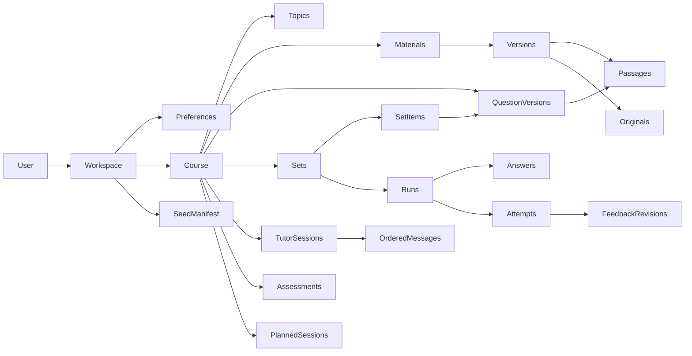

# Schema review

Updated 7 October 2026. This describes the deployed designated development schema
through migration 0016. The application remains a connected personal account app.

## Relationships and authorities

| Area | Final decision and reason |
| --- | --- |
| Identity | Keep Better Auth tables and stable user IDs. Add unique provider/account identity. Personal workspace ownership was already unique. Profile and revisioned preferences remain separate. No sponsored-access or billing tables are needed yet. |
| Topics | Live topic links remain scoped foreign keys. Question and tutor topic IDs and labels are historical identities, deliberately independent of deletable live topics. Removing an outline topic cannot erase learning history. |
| Materials | Keep immutable versions, passages and originals, scoped current-version pointers, upload candidates, leases and byte reservations. Add database validation for note and tutor exact-source references. Publication remains a verified immutable-key promotion, with reconciliation after partial failure. |
| Questions | Each question ID is an immutable version. There is no independent question editing flow requiring another logical-identity table. Keep format-specific keys and rubrics as documents, add required identity/format/difficulty checks and unique questions within a fixed set. Exact sources retain relational foreign keys. |
| Runs | Existing composite keys bind every answer to its run and fixed set. Add positive revisions and completion checks, immutable submitted runs, an answer identity guard, complete-set membership checks and deferred one-attempt finalization. Activation, format eligibility and deadlines remain validated by the locked service transaction. |
| Feedback | Add attempt membership and operation-target validation. Original responses stay in the immutable attempt snapshot. Ordered immutable revisions are the authority for subsequent feedback. Sample feedback has an explicit dataset and method, with no provider operation. Pending answers stay outside graded totals. |
| Tutor | Keep unique ordinal and operation identities. Add allowed states, stages, completion consistency, source/review membership and citation checks. Historical topic labels and bounded context remain. Sample sessions and messages carry explicit provenance. They do not claim live provider output. |
| Planner | Calendar dates remain date columns. Add generated assessment, activity, status and check-in course/time projections, with scoped foreign keys and document/column equality checks. These derive from the document, so callers do not maintain two authorities. Deferred activity-link validation allows atomic imports and protects completion links. Topic arrays remain historical context. Learner timezone governs dates and streaks. |
| AI | Keep integer micro-unit accounting, reservation transactions, uncertain settlement and publication fencing. Add active-execution ownership/state, one-unsettled-execution uniqueness, target validation and terminal settlement protection. Hosted execution is still unavailable, so no speculative runner or lease service was added. |
| Operations | Keep atomic operation receipts and bounded request schemas. Arbitrary receipt expiry would permit an old retry to execute again. No deletion policy was introduced. Existing legacy import envelopes remain for historical records, but new seeds use a small versioned manifest with entity IDs, baseline hashes and source/file references. |

Immutable exam configuration and attempt snapshots describe historical behavior.
Changing a current configuration does not change an existing run or result.
Sample labels affect presentation and provenance, never inject progress totals.

## Migrations and recovery

Before changes, all 14 migration hashes matched the repository. All nine expected
SQL-only material/learning/feedback protection triggers were present. No missing
applied migration or trigger drift was found. The audit captured constraints,
indexes, triggers, row counts and hashes before writing.

The target is project `rawi` (`ancient-smoke-09059218`), database `neondb`, endpoint
`ep-sweet-poetry-b2w0sq3z`. The configured Neon branch is named `production`, but it
is the existing designated development target from `.dev.vars`. No target switch
or production deployment was performed.

A PostgreSQL custom backup is retained in the ignored
`.rawi/schema-account-before.dump`. Rehearsal used
`br-autumn-king-b2p3xs3f`, copied from `br-quiet-wildflower-b2sxzg2f`, with expiry
9 October 2026 at 18:00 UTC. A fresh database on that rehearsal branch also applied
the migration history successfully. App credentials and bindings were unchanged.

| Migration | Mapping and preservation |
| --- | --- |
| 0014 | Adds manifest/provenance fields, generated planner projections, provider uniqueness, chronological indexes and SQL-only guards. Existing JSON supplies generated values. Existing feedback keeps its operation ID and null sample provenance. |
| 0015 | Aligns the Drizzle snapshot with the history expression index on completion time and ID. No learning content changes. |
| 0016 | Strengthens document, answer, attempt, planner and AI guards. Removes unused calendar and receipt-age indexes after reviewing actual query paths. No historical row rewrite. |

All were rehearsed, then applied through Drizzle with direct Neon connections.
Applied migrations were not edited. No immutability trigger was disabled. There
was no destructive cleanup, ID remapping, auth reset or source-file replacement.

## Query shape and verification

The calendar path no longer reads question documents, attempts or passage text.
Planning/progress reads passage metadata only. Tutor/generation context explicitly
requests text for its own course. Complete learning evidence is still aggregated
across all attempts, independently of paginated history.

Attempt history now orders by immutable completion time and ID, descending.
Tutor history orders by creation time and ID, retaining database timestamp
precision in cursors. Scoped cursor lookups reject foreign or missing pivots.
The expression history index matches the actual query. On the seeded development
database, a four-row history page took 0.359 ms in EXPLAIN ANALYZE. PostgreSQL chose
a sequential scan over the small 110-row table, which is appropriate at this size.
No forced index setting or speculative passage search index was added.

The final target and rehearsal matched across 596 catalog object definitions,
with all 17 migration hashes matching. Transactional checks rejected duplicate
provider identities, invalid revisions, submitted-run changes, moved submitted
answers, immutable attempt/file/feedback edits, foreign note sources, feedback for
an absent attempt question, duplicate finalization and submission without an
attempt. All rejection checks rolled back.

Row-level comparisons preserved all original auth, preferences, courses, sources,
files and histories. Two pre-existing planner rows intentionally changed: the
owner's untouched empty default received sample availability, and the isolated
verification workspace revision advanced during manual learning checks. No
existing substantive learner availability was overwritten.

Two early authored expiry snapshots ended five minutes before their configured
35-minute deadline. They remain immutable and visibly carry a timing notice.
Corrected expired examples were appended. Their objective marking was not changed.
New seed runs use the correct deadline. This retained fixture defect is separate
from the verified live rehearsal timing and activation paths.

See FULLSTACK_HANDOFF.md for account counts, actual checks, owner links and the
unavailable browser verification. Hosted AI and binary extraction remain open.
